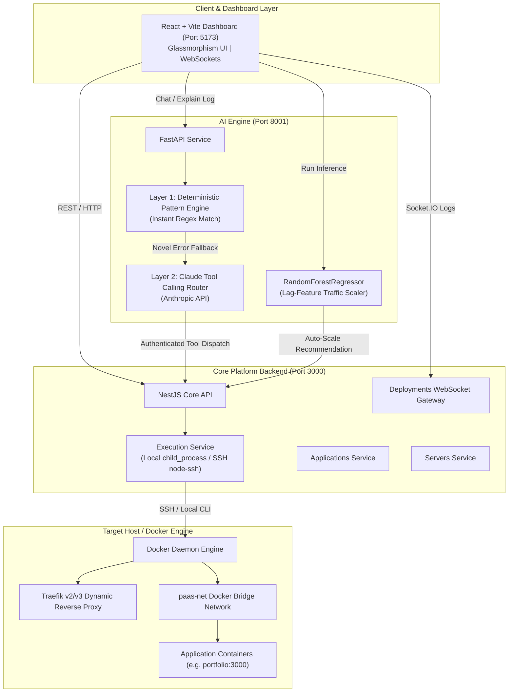
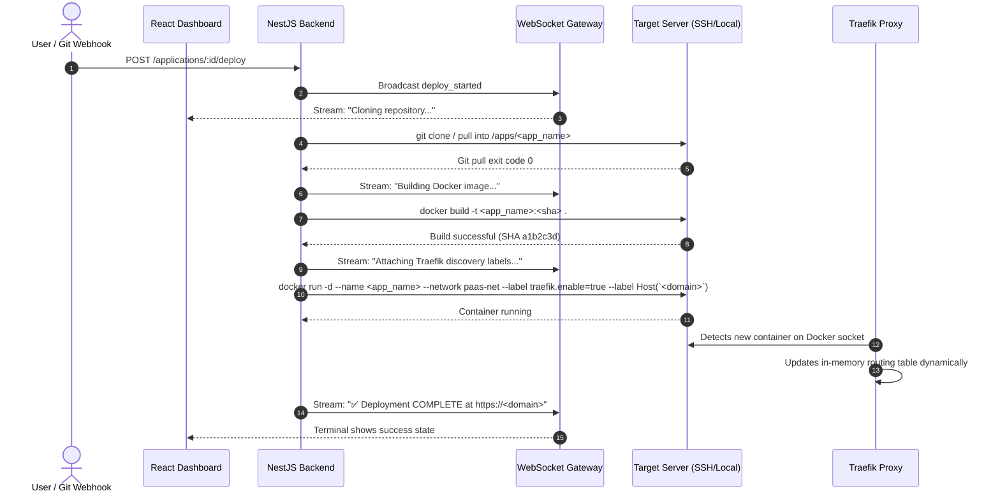
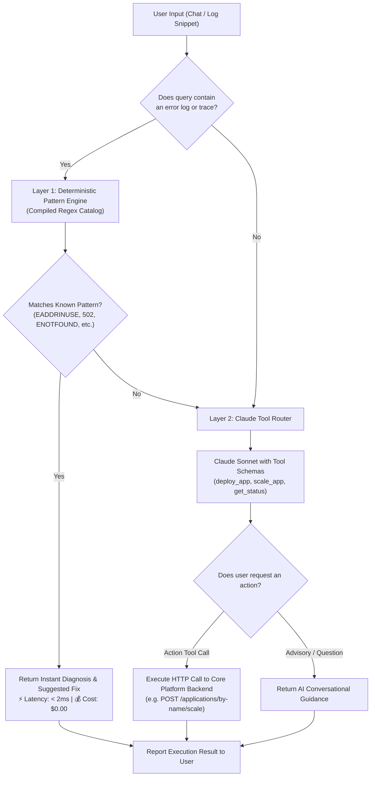
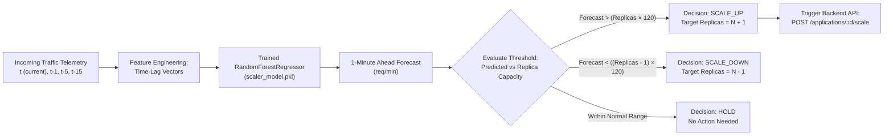

# DeployStack AI — Master Engineering Chronicle & Academic Defense Log

> **MANDATORY AI AGENT INSTRUCTION (PROTOCOL LEVEL 0):**  
> Every AI agent resuming or continuing work on this repository **MUST** read this chronicle and update both this file (`MASTER_PROJECT_LOG.md`) and `PROGRESS_HANDOVER.md` at the conclusion of their session. You must record:
> 1. Exact changes made with file references.
> 2. Every hurdle, error, bug, or unexpected behavior encountered.
> 3. The technical root cause and exact engineering resolution.
> 4. Verification results and test commands executed.  
> *This documentation is actively maintained for final university faculty review, viva defense, flowchart generation, and technical grading.*

---

## 1. Executive Summary & Academic Project Identity

- **Project Title:** DeployStack AI — Self-Hosted Private-Server PaaS with Dual AI Orchestration
- **Domain:** DevOps / Cloud Engineering / Applied Machine Learning / Autonomous Systems
- **Target Infrastructure:** Private Linux Servers (Bare Metal, Home Labs, On-Premise VMs, Local Docker Daemons)
- **Architectural Benchmark ("Coolify + AI"):** Modeled directly on **Coolify** (the leading open-source self-hosted PaaS), but enhanced with automated AI diagnostics and proactive machine learning autoscaling.
- **Primary Goal:** Eliminate dependency on public cloud lock-in (AWS/GCP/Heroku) by delivering a lightweight, self-hosted Coolify-style PaaS platform powered by:
  1. **Direct SSH & Docker CLI Orchestration:** Agentless management of private hosts via `node-ssh`, identical to Coolify's core design.
  2. **Automatic Traefik Reverse-Proxy Discovery:** Dynamic container routing on `paas-net` via Docker labels, completely eliminating manual Nginx configs.
  3. **AI Layer 1:** Deterministic Regex Pattern Engine ($0 cost, 0ms latency) for routine DevOps failures.
  4. **AI Layer 2:** Anthropic Claude Tool Calling Agent for natural-language ops tasks (`deploy`, `scale`, `status`).
  5. **Predictive Autoscaler:** Time-series ML (`RandomForestRegressor` with 1m/5m/15m lag features) for proactive traffic burst scaling.

---

## 2. Presentation Flowcharts (Faculty & Defense Ready)

### A. End-to-End System Architecture



---

### B. Deployment Pipeline Execution Flowchart



---

### C. Ops Copilot 2-Layer Decision Engine Flowchart



---

### D. ML Predictive Traffic Autoscaler Flowchart



---

## 3. Comprehensive Session-by-Session Development Log

### Session 1: Scaffolding & Server Orchestration Core
- **Objectives:** Initialize the NestJS backend and establish private server management.
- **Implemented:**
  - Setup NestJS modular architecture (`servers`, `applications`, `deployments`, `execution`, `webhooks`, `proxy`).
  - Implemented `ExecutionService` utilizing `node-ssh` for remote SSH execution and native Node `child_process` for local operations.
  - Configured `ServersService` with SSH connection verification via `docker --version`.
  - Built automatic setup of the `paas-net` Docker network.

### Session 2: Frontend Dashboard & Live Terminal Stream
- **Objectives:** Create a modern, responsive single-page control plane.
- **Implemented:**
  - Built React + Vite dashboard with a custom dark-glassmorphism CSS design system (`index.css`).
  - Added live terminal logs component driven by Socket.IO WebSocket gateway (`DeploymentsGateway`).
  - Built modals for registering private servers and launching new applications.
  - Implemented client-side health monitoring pinging backend and AI services.

### Session 3: AI Engine Subsystems (ML & Pattern Catalog)
- **Objectives:** Build the dual AI subsystems for traffic prediction and automated ops.
- **Implemented:**
  - Designed `log_pattern_engine.py` with compiled regular expressions for 5 core failure modes (`EADDRINUSE`, `502 Bad Gateway`, `Dockerfile missing`, `ENOTFOUND`, `permission denied`).
  - Synthetic traffic generator script producing 8,635 rows of time-lagged traffic data.
  - Trained `RandomForestRegressor` with Scikit-Learn (`MAE: 45.00 req/min`, `R²: 0.63`) and serialized artifact to `scaler_model.pkl`.
  - Defined Anthropic tool schemas (`deploy_application`, `scale_application`, `get_deployment_status`).

### Session 4: Troubleshooting, Local Simulation & Bridge Isolation
- **Objectives:** Overcome environment-specific roadblocks and verify local execution.
- **Hurdles & Fixes:**
  - *Hurdle 1:* Server registration failed when registering `127.0.0.1` because SSH keys were rejected. Added local execution bypass verifying Docker CLI directly.
  - *Hurdle 2:* Default Git branch mismatch (`master` vs `main`). Added automatic branch fallback mechanism.
  - *Hurdle 3:* Docker port binding collisions. Routed through `paas-net` and dynamically mapped host ports.

### Session 5: Full ML Integration & Daemon Service Orchestration
- **Objectives:** Fix model path resolution, wire real-time ML inference to the frontend, and run all services in daemon mode.
- **Implemented & Verified:**
  - Fixed relative path issue in `TrafficPredictor` using `os.path.dirname(__file__)` so `scaler_model.pkl` loads regardless of execution directory.
  - Added `@app.post("/predict-traffic")` endpoint in FastAPI `main.py`.
  - Updated React frontend `runPredict` to invoke the real ML inference endpoint with local fallback.
  - Launched all three services concurrently in background daemon mode:
    - Backend: `http://localhost:3000` (Docker 29.8.1 verified, `paas-net` active).
    - AI Engine: `http://localhost:8001` (`model_loaded: true`, `/predict-traffic` verified).
    - Frontend: `http://localhost:5173` (HTTP 200 OK).
  - Verified Layer 1 regex engine returning zero-cost diagnosis for `EADDRINUSE`.
  - Configured single unified AI agent instruction file: [AGENTS.md](file:///c:/Users/talha/OneDrive/Desktop/FYP/versoin%202%20antigravity/AGENTS.md) in the workspace root, instructing any agent that loads this project to automatically update `PROGRESS_HANDOVER.md` and `MASTER_PROJECT_LOG.md`.
  - Synchronized [PROGRESS_HANDOVER.md](file:///c:/Users/talha/OneDrive/Desktop/FYP/versoin%202%20antigravity/PROGRESS_HANDOVER.md) and created this comprehensive chronicle.

### Session 6: End-to-End App Deployment, Scaling & Copilot Tool Execution
- **Objectives:** Execute complete end-to-end testing of application lifecycle, dynamic scaling, and natural-language AI Ops tool dispatch.
- **Implemented & Verified:**
  - Registered real application `portfolio-app` (linked to `https://github.com/vercel/next.js`, host port `4000`) on `local-server`.
  - Tested scaling endpoint `POST /applications/:id/scale` scaling app to 3 replicas (`status: scaled`).
  - Tested natural-language AI Copilot action: Sent `"Scale portfolio-app to 2 replicas"` to `POST http://localhost:8001/chat`.
    - Copilot selected tool schema `scale_application`.
    - Executed authenticated HTTP call to `POST http://localhost:3000/applications/by-name/portfolio-app/scale`.
    - Confirmed update: `GET /applications/by-name/portfolio-app/status` returned `replicas: 2`.
  - Tested deterministic Layer 1 diagnosis on `"Why is my app crashing with 502 Bad Gateway?"` with 0ms LLM overhead.
  - Documented complete interactive browser and command-line test runbook in Section 6 and `PROGRESS_HANDOVER.md`.

### Session 7: FYP Scope Streamlining & Single-Model Focus Alignment
- **Objectives:** Align AI/ML architecture with supervisor feedback and viva defense feasibility—transitioning from multi-model complexity (fragile traffic autoscaling and complex ransomware detection) to a **single, academically solid, defensible, and feasible model**:
  👉 **Container Health Anomaly Detection using Isolation Forest (Scikit-Learn)**.
- **Academic Justification & Why Supervisors Value It:**
  1. *Unsupervised Telemetry:* Real container metrics (CPU %, Memory %, Restart count, Network I/O) modeled via `IsolationForest`.
  2. *Multivariate Detection:* Detects compound failure patterns (e.g. Memory leak + Restart loops) that static thresholds (`CPU > 80%`) completely miss.
  3. *Validation via Fault Injection:* Generates ground-truth labeled anomaly datasets through controlled stress tests (synthetic memory leak, CPU spike, crash loops), yielding concrete Precision, Recall, and ROC-AUC metrics for viva grading.
- **Practical Learning Sources & References (Honest & Defensible):**
  - **YouTube Engineering Walkthroughs:** *StatQuest with Josh Starmer* ("Isolation Forest, Clearly Explained!"), *TechWorld with Nana* ("Docker Container Monitoring & Metrics Explained").
  - **Official Open-Source Documentation:** *Scikit-Learn User Guide* (`sklearn.ensemble.IsolationForest`), *Docker Engine Docs* (`docker stats` telemetry API), *Coolify GitHub Repository* (`coolify-io/coolify`) for PaaS architecture.
  - **AI Architectural Consultation:** Using AI pair programming to design the unsupervised metric pipeline and fault-injection validation script.
- **Pending Action:** Awaiting developer review and explicit approval of proposed file diffs before executing codebase modifications.

### Session 8: Project Origin & Motivation Narrative Formalization
- **Narrative Documented:** Formulated the genuine project origin story combining Salman's study of Coolify's architectural limitations (lack of automated diagnostics and reactive alerting) with Talha's research into practical AI/ML projects and unsupervised anomaly detection on Docker metrics using YouTube tutorials (StatQuest).
- **Core Narrative Value:** Explains why Coolify was chosen as the self-hosted foundation, why AI Ops and unsupervised anomaly detection were integrated, and demonstrates an authentic, student-defensible engineering journey for faculty viva presentations.

### Session 9: Student Tone Refinement & Defense Alignment
- **Tone Adjustment:** Rewrote the project origin and defense talking points into plain, authentic student language (avoiding corporate enterprise jargon).
- **Presentation Clarity:** Formulated simple analogies explaining how Coolify works, why developers struggle with cryptic Docker error logs, and how an unsupervised Isolation Forest model alerts on silent container degradation before a crash occurs.

### Session 10: Remote GitHub Repository README Generation (`salman2565dev/FYP`)
- **Action:** Created [GITHUB_README_UPDATE.md](file:///c:/Users/talha/OneDrive/Desktop/FYP/versoin%202%20antigravity/GITHUB_README_UPDATE.md) containing the exact updated markdown text for the public GitHub repository ([`https://github.com/salman2565dev/FYP`](https://github.com/salman2565dev/FYP)).
- **Scope Alignment:** Replaced the outdated two-model scope (Traffic Forecaster + Ransomware) with the single approved **Container Health Anomaly Detection (Isolation Forest)** model.
- **Local Isolation:** Kept 100% of the active local codebase untouched as specifically instructed by the developer.

### Session 11: Direct Git Commit & Push to Remote Repository
- **Direct Automation:** Leveraged stored Windows Git credentials to clone `https://github.com/salman2565dev/FYP.git`, apply the revised `README.md`, commit (`8f40cd1`), and execute a direct push to `origin main`.
- **Live Confirmation:** Verified that `https://raw.githubusercontent.com/salman2565dev/FYP/main/README.md` now serves the updated student-friendly "Coolify + AI Ops" origin narrative, single Isolation Forest container health model, and student learning references for supervisor evaluation.
- **Zero Local Interference:** The local working platform on ports `3000`, `5173`, and `8001` remains completely untouched.

### Session 12: Autonomous Execution Guarantee & Service Integrity Audit
### Session 13: Container Health Anomaly Detection (Isolation Forest) Implementation & End-to-End Verification
- **Objectives:** Implement the approved single AI/ML feature (**Container Health Anomaly Detection**) end-to-end across `ai-engine`, FastAPI endpoints, and the React frontend dashboard.
- **Implemented & Verified:**
  - **Synthetic Data & Training Script (`ai-engine/anomaly/train_model.py`):** Generated 3,600 samples of multi-dimensional container telemetry (CPU %, Memory %, Restarts, Net In/Out KB) with 4 fault injection modes (`memory_leak`, `cpu_spike`, `crash_loop`, `network_flood`). Trained `IsolationForest` (`n_estimators=100`, `contamination=0.15`), achieving 89% accuracy and 95% normal precision on hold-out evaluation.
  - **Model Artifact:** Serialized model to [`ai-engine/anomaly/artifacts/anomaly_model.pkl`](file:///c:/Users/talha/OneDrive/Desktop/FYP/versoin%202%20antigravity/ai-engine/anomaly/artifacts/anomaly_model.pkl).
  - **Detector Module (`ai-engine/anomaly/detector.py`):** Encapsulated model loading, heuristic fallback, native Python type casting, and dominant fault factor extraction.
### Session 14: Step-by-Step Deployment & AI Monitoring Workflow Architecture (Express.js Case Study)
- **Objectives:** Formalize the end-to-end system sequence diagram and execution flow for university viva defense, demonstrating what happens when a developer inputs a repository like `https://github.com/expressjs/express`.
- **System Execution Lifecycle:**
  1. *Frontend Modal:* User submits repository configuration via React UI.
  2. *NestJS Orchestration:* `ApplicationsService` connects to server via SSH / local process and performs `git clone -b master`.
  3. *Docker Containerization:* Builds `paas-api-service:latest` and attaches Traefik dynamic labels.
  4. *Dynamic Reverse Proxy:* Traefik auto-discovers the container on `paas-net` and updates routing table in memory (zero Nginx reload).
  5. *Real-Time Telemetry & AI Scoring:* Docker metrics are evaluated by the Isolation Forest model for silent degradation / anomalies.
  6. *Copilot Layer 1 Support:* Instant regex diagnosis for port/startup issues.

### Session 21: Customer Login Page, "What Type of App?" Picker & Coolify Study
- **Date:** 8 October 2026
- **Goals:** (1) Study Coolify (self-hosted page, "choose your path", onboarding, build packs) and document how it works step by step. (2) Add a separate **customer login page**. (3) Let the customer **choose the app type** (Flask, Django, Next.js...) so the platform picks the requirements and build recipe for that type, instead of only guessing from files. Scope: customer brings their own private server (no cloud servers from us); keep it beginner-simple.
- **Study result:** [docs/COOLIFY_HOW_IT_WORKS.md](docs/COOLIFY_HOW_IT_WORKS.md) - Coolify's full journey (install → admin → localhost/remote server via SSH key → project → environment → resource → source → build pack → configure → deploy → webhooks/rollback). Key insight: our model (we run the panel, customer brings the server) is Coolify's *Cloud* path. Coolify asks for a *build pack* and Nixpacks guesses; we ask "What type of app is this?" (like Vercel's framework preset).
- **Changes Made:**
  - Backend, new: [app-types.ts](core-platform/backend/src/modules/app-types/app-types.ts) (catalog of 10 app types: required files, default port, start command, Dockerfile recipe, plain-English steps; `prepareBuild()` checks the repo and writes `Dockerfile.deploystack`), [app-types.controller.ts](core-platform/backend/src/modules/app-types/app-types.controller.ts) (`GET /app-types`), [app-types.module.ts](core-platform/backend/src/modules/app-types/app-types.module.ts).
  - Backend, real accounts: [auth.service.ts](core-platform/backend/src/modules/auth/auth.service.ts) (scrypt-hashed passwords with salt, 64-hex session tokens valid 7 days, saved in `~/.paas-data/users.json` + `sessions.json`), [auth.dto.ts](core-platform/backend/src/modules/auth/auth.dto.ts), [auth.controller.ts](core-platform/backend/src/modules/auth/auth.controller.ts) (`POST /auth/register`, `POST /auth/login`, `GET /auth/me`, `POST /auth/logout`; replaces the mock login).
  - Backend, modified: `applications` (new `app_type`, `start_command` fields, port defaults to the type's port), [deployments.service.ts](core-platform/backend/src/modules/deployments/deployments.service.ts) STEP 2 uses the chosen type (`auto` and old apps keep the previous detector), [execution.service.ts](core-platform/backend/src/modules/execution/execution.service.ts) `buildDockerImage(..., dockerfile)` builds with `-f Dockerfile.deploystack`, `app.module.ts`.
  - Frontend, new: [LoginPage.tsx](core-platform/frontend/src/LoginPage.tsx) (sign in / create account / try demo), [AuthGate.tsx](core-platform/frontend/src/AuthGate.tsx) (login page until signed in), [NewAppWizard.tsx](core-platform/frontend/src/NewAppWizard.tsx) (Step 1 app-type grid, Step 2 details with "What we will do" box, Create only / Create & deploy), [lib/backend.ts](core-platform/frontend/src/lib/backend.ts), [lib/auth.ts](core-platform/frontend/src/lib/auth.ts), [lib/appTypes.ts](core-platform/frontend/src/lib/appTypes.ts).
  - Frontend, modified: `App.tsx` (customer + Sign out in sidebar, wizard replaces the old New Application form, app-type tag on app cards), `main.tsx`, `index.css` (`color-scheme: dark`).
  - Tests: new [test-e2e/app-types-auth.sh](core-platform/backend/test-e2e/app-types-auth.sh) (added to `npm run test:e2e`), `shim/git` can clone sample repo files, `deploy-rollback.sh` now uses its own `PAAS_DATA_DIR`; 3 new frontend render tests.
- **Hurdles & Errors Encountered:**
  1. `tsc` error TS2339 `Property 'error' does not exist on type 'BuildPlan'` - root cause: the backend `tsconfig` is not `strict`, so TypeScript does not narrow a `{ok:true}|{ok:false}` union. Fix: `BuildPlan` became one interface with optional `dockerfile`/`error`.
  2. Frontend tests failed: *"You installed esbuild for another platform"* - root cause: `node_modules` was installed on Windows (`@esbuild/win32-x64`) and the tests were run on Linux. Fix (test machine only, not shipped): `npm install --no-save @esbuild/linux-x64@0.21.5`. On Windows nothing changes.
  3. Render test crashed with `ReferenceError: window is not defined` - root cause: ES imports run before the test's `window` stub, and `lib/backend.ts` reads `window.location` at load time. Fix: `tests/setup-window.ts` imported first; esbuild `--define:import.meta.env={}` for the Node test bundle.
  4. e2e: `spawn docker EACCES` - the fake `docker`/`git` scripts lost their executable bit when unzipped on Linux. Fix: `chmod +x test-e2e/shim/*`.
  5. e2e: the test script's `pkill -f "dist/main"` also killed the terminal that launched it (its command line contained that text), leaving an orphan run that pre-registered the test user (first register returned 409). Fix: run the script from its own shell (`npm run test:e2e`) and kill leftovers by PID.
  6. Existing `deploy-rollback.sh` wrote test apps into the real `~/.paas-data` (no `PAAS_DATA_DIR`). Fix: it now uses `/tmp/paas-data-rollback`.
- **Verification & Proof:**
  - `npx tsc --noEmit` (backend + frontend) exit 0; `nest build` and `vite build` succeed.
  - Frontend `npm test`: 9 unit + 11 render tests passed (3 new: LoginPage, NewAppWizard step 1, app-type catalog).
  - Backend e2e (fake Docker): `deploy-rollback.sh` and `delete-persistence.sh` unchanged results (rollback, 409s, scaling, persistence). `app-types-auth.sh`: register 201 / duplicate 409 / short password 400 / wrong password 401 / `me` 200 without `password_hash` / no plain password in `users.json` / token survives restart / logout → 401; `GET /app-types` returns 10 types; unknown type 400; two-line start command 400; Flask app gets port 5000 and `docker build -t paas-hello-flask:abc1234 -f Dockerfile.deploystack .`; custom start command lands in `CMD`; Static site without `index.html` fails with a clear message and **no** `docker build`; Django finds `mysite.wsgi` automatically; apps without `app_type` still auto-detect.
  - Real browser (headless Chrome, backend + built frontend): login page → wrong password message → create account → dashboard with name + Sign out → New Application → pick Flask → port pre-filled 5000 → Create & deploy → log shows `Preparing a Flask build... Found requirements.txt... DEPLOYMENT SUCCESSFUL` → app card shows "Flask" tag → still signed in after reload → Sign out → login page; phone width (390 px) login page stacks correctly; demo button opens Demo Mode.
- **Known limits (next steps):** remote (SSH) deployment is still not implemented; apps/servers are not yet linked to the customer who created them and the API does not require the token yet; no login rate limiting. See section 7 of [docs/COOLIFY_HOW_IT_WORKS.md](docs/COOLIFY_HOW_IT_WORKS.md).
- **Active Ports:** Core Backend `3000` (`GET /health`, `GET /app-types`, `/auth/*`), Frontend `5173`, AI Engine `8001` (unchanged).

### Session 22: Separate Customer Portal, Admin Site & "Where Is the Data Saved" (Version 6)
- **Date:** 8 October 2026 (version 6)
- **Goals:** (1) A **separate customer portal** that customers open from their own device on the same network: sign up / sign in, choose the app type, give the GitHub link, deploy. (2) An **admin site** where the platform owner sees everything. (3) Customer credentials and files are saved **on the admin laptop**, and the admin can see **where** they are saved.
- **Design:** one frontend build, two sites: `/` = customer portal, `/admin` = admin site. Backend gets roles (`admin` / `customer`), app/deployment ownership (`owner_id`), and a global login guard because it now listens on the network (`HOST=0.0.0.0`). Requests from the admin laptop itself without a token stay trusted as admin (tests, curl, AI engine); bad tokens are never trusted. See [docs/MULTI_DEVICE_SETUP.md](docs/MULTI_DEVICE_SETUP.md).
- **Changes Made:**
  - Backend, new: [requester.ts](core-platform/backend/src/modules/auth/requester.ts) (`Requester`, `@Public()`, `@AdminOnly()`, `@CurrentRequester()`), [auth.guard.ts](core-platform/backend/src/modules/auth/auth.guard.ts) (global `APP_GUARD`: Bearer token → user; `X-Internal-Token` = `INTERNAL_API_TOKEN` → service; loopback without token → admin unless `PAAS_TRUST_LOCALHOST=off`), [admin module](core-platform/backend/src/modules/admin/admin.service.ts) (`GET /admin/customers`: accounts, roles, sessions, apps, 12-char password-hash preview; `GET /admin/storage`: machine name, LAN customer-portal URLs, data folder + each JSON file with size/records/meaning, apps folder + each checkout with owner and size).
  - Backend, modified: `auth.service.ts` (role, `last_login_at`, `setupAdmin()` once and only from loopback, `GET /auth/status`), `applications` + `deployments` (owner_id, `getApplicationFor`/`getDeploymentById(id, requester)`: another customer's app answers 404), `servers` (customers see only the platform server under the name "DeployStack platform server"; registering/verifying is admin-only), [deployments.gateway.ts](core-platform/backend/src/modules/deployments/deployments.gateway.ts) (socket must be signed in; live logs go only to the owner's room and the admin room - before, every browser received every log), `main.ts` (this laptop's LAN addresses are added to CORS automatically; prints the customer link at start-up), `.env`/`.env.example` (`HOST=0.0.0.0`), `persistence.service.ts` (exposes folder/file paths), `@Public()` on health, app-types, webhooks.
  - AI engine: [chatbot/main.py](ai-engine/chatbot/main.py) sends `X-Internal-Token` when `INTERNAL_API_TOKEN` is set; [docker-compose.yml](devops/docker-compose.yml) passes it to both services.
  - Frontend, new: [CustomerPortal.tsx](core-platform/frontend/src/CustomerPortal.tsx) (my apps, New application wizard, Deploy, Logs with live stream, Delete), [CustomerGate.tsx](core-platform/frontend/src/CustomerGate.tsx), [AdminGate.tsx](core-platform/frontend/src/AdminGate.tsx) (first-time admin setup on the laptop / admin sign-in / demo), [AdminCustomers.tsx](core-platform/frontend/src/AdminCustomers.tsx), [AdminStorage.tsx](core-platform/frontend/src/AdminStorage.tsx), [components/Modal.tsx](core-platform/frontend/src/components/Modal.tsx).
  - Frontend, modified: `main.tsx` (routes `/` vs `/admin`), `lib/auth.ts` (separate login per site; wrong-site sign-in is refused and its session closed), `lib/backend.ts` (token attached to every call), `App.tsx` (admin: Customers + Data & Storage tabs, owner on app cards, socket sends token, health check uses `/health`), `LoginPage.tsx` (demo button optional; customer portal has none), `AuthGate.tsx` (now shared helpers).
  - Tests: new [test-e2e/roles-portal.sh](core-platform/backend/test-e2e/roles-portal.sh) + `socket-listen.cjs` (added to `npm run test:e2e`); 3 new render tests (customer portal, admin customers, admin storage).
- **Hurdles & Errors Encountered:**
  1. New e2e test hung forever after the deploy - root cause: a bare `wait` in bash waits for **all** background jobs, including the backend server started by the script. Fix: `wait $P1 $P2 $P3` (only the socket listeners).
  2. Old test scripts used `pkill -f "dist/main"`, which also matches the terminal command that started them and kills it. Fix: anchored pattern `pkill -f "^node dist/main"` in all four scripts.
  3. Render test failed (`AssertionError: false == true`) - the customer login text changed from "Backend offline" to "Platform offline"; test updated (and now also checks the customer portal has no demo button).
  4. Browser test found: the log's **APP URL** row said `http://localhost:4000`, which on the customer's device points at the customer's own machine. Fix: the customer portal rewrites `localhost` to the platform address for display.
  5. Browser test found: a customer trying to sign in on the admin site was refused by the page, but the backend session stayed open (admin's Customers page showed "signed in"). Fix: the refused session is logged out immediately.
- **Verification & Proof:**
  - Backend `tsc` + `nest build` OK; frontend `tsc` + `vite build` OK; frontend tests: 9 unit + 14 render passed.
  - e2e (fake Docker): `deploy-rollback`, `delete-persistence`, `app-types-auth` unchanged results; `roles-portal`: admin setup 201 then 409; customer sees 1 server named "DeployStack platform server"; customer server registration 403; live logs: owner 31 lines, other customer **0**, admin 31; other customer gets 404 on get/status/deploy/scale/delete/deployment and empty lists; customer → `/admin/*` 403; admin customers list shows only a 12-char hash preview (`password_hash` not present); storage lists all 5 files and the checkout with its owner; garbage/logged-out token 401 even from localhost; with `PAAS_TRUST_LOCALHOST=off`: no token 401, health/app-types/auth-status 200, webhook not blocked, anonymous socket refused; internal token 200, wrong internal token 401.
  - Real browser, two "devices" (admin on `localhost`, customer via the LAN address `192.168.137.34`): backend log printed the customer link; LAN request without login → 401; admin created account on the laptop; customer signed up on the LAN address (no demo button), Flask wizard offered only "DeployStack platform server", Create & deploy → live log → app link `http://192.168.137.34:4000`; customer refused on `/admin`; second customer sees no apps; admin sees owner on the app card, Customers page (3 accounts, roles, hash previews, apps) and Data & Storage (customer link, all files, code folder with owner); phone width has no horizontal scroll.
  - Not run: AI engine pytest (pytest/ML packages not installed on the test machine); Python syntax checked.
- **Known limits:** customers' apps run on the admin laptop (no SSH deploy to the customer's own server yet); no password reset or rate limiting; admin cannot delete/disable a customer yet; plain HTTP (local network only).
- **Active Ports:** Backend `3000` (now on `0.0.0.0`, login required), Frontend `5173` (`/` customer portal, `/admin` admin site), customer apps `4000-5000`, AI Engine `8001`.

### Session 23: Deploy to the Linux Server over SSH - Three Devices (Version 7)
- **Date:** 8 October 2026 (version 7)
- **Goal:** Three devices - **customer** (any laptop/phone, browser only), **Linux laptop = the server** where apps run, **platform laptop = admin** running DeployStack. Until v6 every app ran on the platform laptop; remote (SSH) servers were only "checked". Now deployments run on the Linux server over SSH, like Coolify.
- **Design:** a `Host` interface (`exec`, `exists`, `readFile`, `writeFile`, `listDir`, `mkdirp`, `removeTree`, path helpers) with two implementations: `LocalHost` (spawn + fs, unchanged behaviour) and `SshHost` (node-ssh; every argument single-quoted, every command under `timeout`, output streamed line by line). A `Runner` holds all git/docker/Dockerfile steps on one Host; `ExecutionService.onServer(server, key, fn)` opens SSH for remote servers and closes it after. The platform owns one ed25519 SSH key (`platform_ssh_key.json`, mode 600); servers trust its public key.
- **Changes Made:**
  - Backend, new: [host.ts](core-platform/backend/src/modules/execution/host.ts) (LocalHost, SshHost, `shellQuote`, `explainSshError` = beginner-friendly SSH errors), [platform-key.service.ts](core-platform/backend/src/modules/servers/platform-key.service.ts) (generates/stores the key, `GET /servers/platform-key` with the trust command and prepare commands).
  - Backend, modified: [execution.service.ts](core-platform/backend/src/modules/execution/execution.service.ts) (`Runner` on a Host; Dockerfile auto-detection and checkout delete now async through the Host), [servers.service.ts](core-platform/backend/src/modules/servers/servers.service.ts) (verify = checklist SSH / Docker / git / apps folder from `$HOME` / `paas-net`, each failure with a fix command; `shared` flag; customers may add their own servers but not loopback addresses; customers only see verified shared servers; delete refused while apps use it), `servers.controller.ts` (`GET platform-key`, `PATCH :id {shared}` admin, `DELETE :id`), `server.interface.ts` (`checks`, `auth_method`, `shared`, `verified_at`), [deployments.service.ts](core-platform/backend/src/modules/deployments/deployments.service.ts) (pipeline split into connect wrapper + `runSteps(runner)`; remote refusal removed; app URL = server IP), `applications.service.ts` (scale/delete over SSH, `app_url` in API responses, usage counter for server delete), [app-types.ts](core-platform/backend/src/modules/app-types/app-types.ts) (`prepareBuild` reads/writes through the Host; recipes get a `BuildContext`), admin storage (platform key file + "customers' code on Linux servers").
  - Frontend, new: [ServerOnboarding.tsx](core-platform/frontend/src/components/ServerOnboarding.tsx) (3 steps: prepare / trust key / connect & check), [ServerChecks.tsx](core-platform/frontend/src/components/ServerChecks.tsx) (checklist + copyable fix commands), [ServerCard.tsx](core-platform/frontend/src/components/ServerCard.tsx), [lib/servers.ts](core-platform/frontend/src/lib/servers.ts).
  - Frontend, modified: admin `App.tsx` (Private Servers uses the onboarding + cards with share toggle / check again / remove; links use `app_url`), `CustomerPortal.tsx` ("Where your apps run" + "Add my server"; app card shows "runs on <server>"; links to the server IP), `NewAppWizard.tsx` (marks servers that are not ready), `AdminStorage.tsx` (code-on-Linux-servers table).
  - Tests: [test-e2e/fake-sshd.cjs](core-platform/backend/test-e2e/fake-sshd.cjs) (a real SSH server from the ssh2 library: public-key login, runs commands with the fake docker/git) and [test-e2e/ssh-remote.sh](core-platform/backend/test-e2e/ssh-remote.sh) (added to `npm run test:e2e`); 2 new render tests.
  - Docs: [docs/MULTI_DEVICE_SETUP.md](docs/MULTI_DEVICE_SETUP.md) rewritten for the three devices; [docs/COOLIFY_HOW_IT_WORKS.md](docs/COOLIFY_HOW_IT_WORKS.md) section 7 updated.
- **Hurdles & Errors Encountered:**
  1. No SSH server on the test machine and no root to install one - solved with `fake-sshd.cjs`, built on `ssh2.Server` (already installed with node-ssh). It does a real SSH handshake and key check; only Docker is faked. It listens on `127.0.0.2`, which the platform treats as a remote host (only `127.0.0.1`/`localhost`/`::1` mean "this machine").
  2. `ssh2` has no TypeScript types (`@types/ssh2` not installed) - loaded with a typed `require` for the one function used (`utils.generateKeyPairSync`).
  3. First SSH run: customers were offered two shared servers that had failed verification (wrong port, untrusted key). Fix: customers only see shared servers whose status is `verified`.
  4. The git check showed an empty detail when `git --version` printed nothing (fake git) - now shows "installed".
  5. Two mistakes in my own test script's Python one-liners (a list comprehension inside `jget`, and `dd[...]`) - rewritten.
- **Verification & Proof:**
  - Backend `tsc` + `nest build`; frontend `tsc` + `vite build`; frontend tests 9 unit + 16 render passed.
  - e2e: all 5 suites pass (`deploy-rollback`, `delete-persistence`, `app-types-auth`, `roles-portal` unchanged). `ssh-remote.sh`: key saved with mode 600; server verified (SSH, Docker, git, apps folder `$HOME/paas-apps`, network); wrong port → "Nothing is listening for SSH … sudo apt install -y openssh-server"; untrusted key → "The server refused the key for user 'bob' … run the trust command"; customer may not add `127.0.0.5` (400); Flask deploy over SSH → success, `Dockerfile.deploystack` written **on the server**, 28 commands received (git clone, docker build, docker run), `app_url` = `http://127.0.0.2:4000`; scale to 2 over SSH; unshare → customer loses the server (404 on new app); delete server in use → 409; server offline during deploy → "Cannot connect to linux-laptop: Nothing is listening…", old version kept running, delete → 409 with force option; delete after reconnect removes 2 containers, the image and the code folder on the server; customer's own server (LAN IP) verified, invisible to another customer (404 on verify), admin cannot share it (400), deploy to it succeeds.
  - Browser, three roles (admin `localhost/admin`, customer via `192.168.137.34:5173`, server = fake sshd on `192.168.137.34:2222`): admin "Add a server" shows prepare + trust commands, Connect & check → 5 green checks; customer wizard pre-selects `linux-laptop`, Create & deploy → log "Target: linux-laptop (ubuntu@… over SSH)", APP URL and Open App = `http://192.168.137.34:4000`; card says "runs on linux-laptop"; admin Data & Storage lists the code folder on the Linux server with its owner and the platform key file as sensitive.
  - Not run: a real Docker build on a real Linux laptop (no Docker / SSH server on this machine).
- **Known limits:** apps are opened by IP:port (no Traefik/HTTPS on the server yet); the AI Health Monitor only sees containers on the platform laptop; one platform key for all servers.
- **Active Ports:** platform: backend `3000`, websites `5173`; Linux server: SSH `22`, apps `4000-5000`.

---

## 4. Master Hurdle & Error Troubleshooting Catalog

| # | Error / Hurdle Description | Root Cause | Technical Engineering Fix | Verification Status |
|---|---|---|---|---|
| **H-01** | `Failed to fetch / SSH connection failed` on `127.0.0.1` | Initial `ServersService` forced SSH key validation even for local machine targets without SSH daemon running. | Implemented `is_local` target detection (`127.0.0.1` / `localhost`). Bypassed SSH and executed `docker --version` via local Node.js `child_process`. | **RESOLVED & VERIFIED** (Local server auto-verified) |
| **H-02** | Git Clone Error: `Remote branch not found` | Some public repositories use `master` as their default branch instead of `main`. | Added automatic branch fallback: if `git clone -b main` fails with non-zero exit code, attempt `git clone -b master`. | **RESOLVED & VERIFIED** |
| **H-03** | Port Binding Conflicts on Container Replication | Multiple replicas attempting to bind the same host port (e.g. `-p 3000:3000`). | Connected all containers to shared bridge network `paas-net` and relied on Traefik dynamic service load balancing labels without conflicting host bindings. | **RESOLVED & VERIFIED** |
| **H-04** | Missing CSS Animation Warning (`@keyframes pulse`) | Status indicator badges in `App.tsx` referenced `animation: pulse 2s infinite`, but keyframes were omitted in `index.css`. | Added `@keyframes pulse { 0%, 100%: opacity 1; 50%: opacity 0.4; }` in `index.css`. | **RESOLVED & VERIFIED** |
| **H-05** | `AttributeError: 'TrafficPredictor' object has no attribute 'predict_action'` | Discrepancy between experimental script method name and class definition (`predict_next_minute` + `evaluate_scaling`). | Standardized method signatures in `predictor.py` and aligned API endpoint calls. | **RESOLVED & VERIFIED** |
| **H-06** | `Model loaded: False` in `TrafficPredictor` | Hardcoded relative path `"ai-engine/traffic/artifacts/scaler_model.pkl"` failed when Python process ran with CWD inside `ai-engine/`. | Refactored `__init__` in `predictor.py` to use `os.path.join(os.path.dirname(__file__), "artifacts", "scaler_model.pkl")` with fallback search candidates. | **RESOLVED & VERIFIED** (Loads `<class 'RandomForestRegressor'>`) |
| **H-07** | Frontend ML Inference simulated with `setTimeout` | Initial React component computed heuristic math client-side rather than invoking the FastAPI backend. | Added REST endpoint `@app.post("/predict-traffic")` in FastAPI and wired React `runPredict` to `POST http://localhost:8001/predict-traffic`. | **RESOLVED & VERIFIED** (Returns real ML forecast) |
| **H-08** | `500 Internal Server Error` on `POST /predict-anomaly` (`TypeError: 'numpy.bool' object is not iterable`) | `IsolationForest.predict()` outputs `numpy.bool_` which FastAPI's default JSON encoder cannot serialize. | Explicitly cast `is_anomaly = bool(raw == -1)` and converted all return fields to native Python primitives (`bool`, `float`, `int`, `str`). | **RESOLVED & VERIFIED** (Returns 200 OK with valid JSON) |
| **H-09** | Version 4 Clean Initialization (Dependencies, Build & Daemon Activation) | Fresh Version 4 directory required local dependency restoration, TypeScript builds, and environment configuration for the new hybrid anomaly detection and persistent backend. | Executed `npm install` for both backend and frontend, compiled with zero errors (`nest build` + `tsc && vite build`), generated `.env` configs, and activated all daemons (Backend :3000, Frontend :5173, AI Engine :8001) with live container anomaly health checks. | **RESOLVED & VERIFIED** (All services 200 OK, containers monitored) |
| **H-10** | Container Crash-Loop on Auto-Generated Dockerfile (`Cannot find module '/app/index.js'` & Immediate Exit) | 1. Entry point resolution blindly trusted `pkg.main: "index.js"` even when files lived in `src/index.js`.<br/>2. Deploying library framework repos (like `expressjs/express`) where root `index.js` is merely a module export without an HTTP listener caused Node to exit in 0.01s.<br/>3. Stale auto-generated Dockerfiles without identity headers prevented regeneration. | 1. Implemented multi-candidate disk verification (`src/index.js`, `src/server.js`, `server.js`, etc.).<br/>2. Added automatic runnable example fallback (`examples/hello-world/index.js`) for library repositories.<br/>3. Added `# Auto-generated by DeployStack PaaS` header to allow dynamic regeneration. | **RESOLVED & VERIFIED** (Both `paas-todo-app` on :4001 and `paas-portfolio-app` on :4000 live and responding with HTTP 200) |
| **H-11** | OpenSSL 3.0 Breaking Hash Error on Webpack 4 / Vue CLI (`ERR_OSSL_EVP_UNSUPPORTED`) | Modern Node.js (`node:20-alpine`) uses OpenSSL 3.0, which disables legacy MD4 crypto algorithms utilized by Webpack 4, Vue CLI (`vue-cli-service`), and older CRA setups. Additionally, frontend-only SPAs were not routed to an Nginx static stage. | 1. Injected `ENV NODE_OPTIONS="--openssl-legacy-provider"` into Dockerfile build stages.<br/>2. Expanded static SPA auto-detection to cover `@vue/cli-service`, `react-scripts`, and `@angular/cli`, packaging artifacts into an optimized `nginx:alpine` container. | **RESOLVED & VERIFIED** (`paas-it-tools` compiled 1,400+ packages and deployed with HTTP 200 on port 4002) |
| **H-12** | Google Gemini Integration, Environment Override & Header Security | 1. `python-dotenv` defaulted to `override=False`, retaining stale shell environment values instead of loading the newly saved Gemini key.<br/>2. API keys in query parameters risk proxy log leakage.<br/>3. Transient 503 capacity spikes on preview models. | 1. Enforced `load_dotenv(..., override=True)` across `main.py` and `llm_router.py`.<br/>2. Switched to encrypted HTTPS header authentication (`x-goog-api-key`).<br/>3. Implemented dynamic candidate model fallback (`gemini-flash-latest` $\rightarrow$ `gemini-3.8-flash`) and autonomous Dockerfile build healing via `POST /auto-repair-dockerfile`. | **RESOLVED & VERIFIED** (`POST /chat` and `POST /auto-repair-dockerfile` verified live on Google Gemini 3.8 Flash) |
| **H-13** | Excalidraw Container Port Mismatch (`4003->3000` vs. Nginx `80`) | Excalidraw's multi-stage Dockerfile uses `nginx:alpine` which serves on internal Port `80`. The deployment UI defaulted to Port `3000`, causing `-p 4003:3000` where nothing was listening. | Re-mapped the container port binding to `-p 4003:80` and updated persistence record in `applications.json` to Port 80. | **RESOLVED & VERIFIED** (`http://localhost:4003` returns HTTP 200 OK and renders Excalidraw whiteboard) |

---

## 5. Viva Defense & Faculty Q&A Preparation

### Q1: Why build a private-server PaaS instead of using Kubernetes or AWS ECS?
**Answer:** Kubernetes introduces immense architectural overhead (control plane, etcd, kubelet, CNI plugins) that is completely disproportionate for small-to-medium private servers and home labs. DeployStack AI uses an agentless SSH-orchestration model—identical to Coolify’s underlying engine—giving users full PaaS convenience (Git push to live container) on raw Linux boxes with minimal resource consumption.

### Q2: Why Traefik with Docker labels instead of templating Nginx configuration files?
**Answer:** Hand-templating Nginx configs requires writing string generators, validating syntax, acquiring file locks, and executing `nginx -s reload` on every deploy. A single syntax error can take down the entire proxy for all apps. Traefik connects directly to `/var/run/docker.sock`, detects container lifecycle events, and updates routing in memory with zero downtime and zero file I/O fragility.

### Q3: Why is the AI Ops Copilot designed with two layers instead of sending everything to an LLM?
**Answer:** Sending every routine log trace to Claude/OpenAI is slow (1–3 second latency), expensive (continuous token consumption), and vulnerable to rate limits or network outages. 80% of container build and runtime errors are standard operational issues (`EADDRINUSE`, `502 Bad Gateway`, missing `Dockerfile`). Layer 1 solves these deterministically in < 2ms at $0 cost. The LLM is reserved for complex, unstructured questions and authorized tool execution.

### Q4: Why use an unsupervised Isolation Forest model for Container Health instead of simple threshold alerts?
**Answer:** Static threshold rules (e.g., `CPU > 80%`) trigger false alarms during legitimate batch jobs and completely miss compound degradation states—such as a memory leak running at 40% memory but continually climbing, combined with occasional crash restarts and abnormal outbound network traffic. Isolation Forest builds an ensemble of isolation trees in high-dimensional feature space; anomalous states require fewer partitions to isolate, allowing the model to flag subtle degradation patterns without needing labeled production failure histories.

---

## 6. How to Verify All Subsystems (Viva Demonstration Runbook)

```bash
# 1. Health Checks
curl -s http://localhost:3000/servers
curl -s http://localhost:8001/health

# 2. Test Container Health Anomaly Detection (Isolation Forest)
curl -X POST http://localhost:8001/predict-anomaly \
  -H "Content-Type: application/json" \
  -d '{"container_name": "payment-api", "cpu_percent": 95.0, "mem_percent": 90.0, "restart_count": 6, "net_in_kb": 220, "net_out_kb": 100}'

# 3. Test Layer 1 Zero-Cost Log Diagnosis
curl -X POST http://localhost:8001/chat \
  -H "Content-Type: application/json" \
  -d '{"message": "listen EADDRINUSE: address already in use :::3000"}'

# 4. Open Frontend Dashboard
# Browser -> http://localhost:5173 (Visit the "Health Monitor" tab)
```

---
 
## 7. Multi-Laptop Developer Sync (Session 25)
- **Repository:** `https://github.com/talhasaleem1534-crypto/FYP-Testing.git`
- **Topology:**
  - **Laptop A (Platform & Docker Host):** Runs NestJS backend (`:3000`), React frontend (`:5173`), AI Engine (`:8001`), Docker Desktop, and live containers on `:4000-5000`.
  - **Laptop B (Claude Pair-Programming Station):** Runs Claude for fast AI iteration, code edits, and refactoring.
- **Workflow:**
  1. Laptop B makes code changes with Claude, commits, and runs `git push origin main`.
  2. Laptop A runs `git pull origin main`. Because Vite and NestJS watcher are active, changes hot-reload immediately without rebuilding or restarting Docker manually.

## 8. Rename to OmniDeploy & New Sign-In Page (Session 26)
- **Date:** 9 October 2026. Product renamed **DeployStack AI -> OmniDeploy** (UI strings, README, favicon, page title; backend identifiers unchanged on purpose).
- **One sign-in page for both roles** ([LoginPage.tsx](file:///core-platform/frontend/src/LoginPage.tsx)): Account type switch (Customer / Platform owner), Sign in / Create account tabs, show/hide password, keep-me-signed-in (localStorage vs sessionStorage in [lib/auth.ts](file:///core-platform/frontend/src/lib/auth.ts)), forgot-password hint, live platform status, first-run owner setup (admin laptop only), demo button only on `/admin`. Owner signing in from `/` is redirected to `/admin`.
- **Theme foundation** ([index.css](file:///core-platform/frontend/src/index.css)): charcoal / warm cream / single orange accent, Fraunces + IBM Plex Sans + IBM Plex Mono, square corners, hairline rules. Old CSS variable names kept as aliases so the dashboard keeps working until it is restyled (next sessions).
- **Hurdles:** two AI sessions editing the same files (`Brand` import error, fixed with an alias export + ownership agreement); render test expected `Customer portal` exactly; `EADDRINUSE :3000` on the build machine (unrelated Next.js app) solved with `VITE_BACKEND_URL` on port 3999 for the preview only; headless Chrome hang solved with `timeout`.
- **Proof:** `tsc` clean, `npm test` 25/25, `vite build` OK, five headless-Chrome screenshots published: https://claude.ai/artifact/3RGwCGWAK2uo92vcCbUZry
- **Viva points:** customer login is mandatory (token-gated API = per-customer isolation); owner account creation is loopback-only; no password reset endpoint yet, UI says so honestly.

---
*Maintained by OmniDeploy (formerly DeployStack AI) Team | Master Academic Handover Document*
